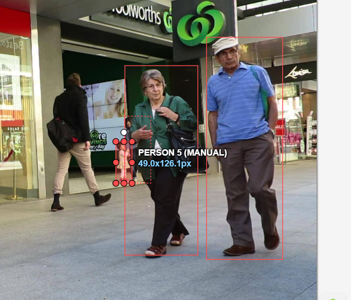
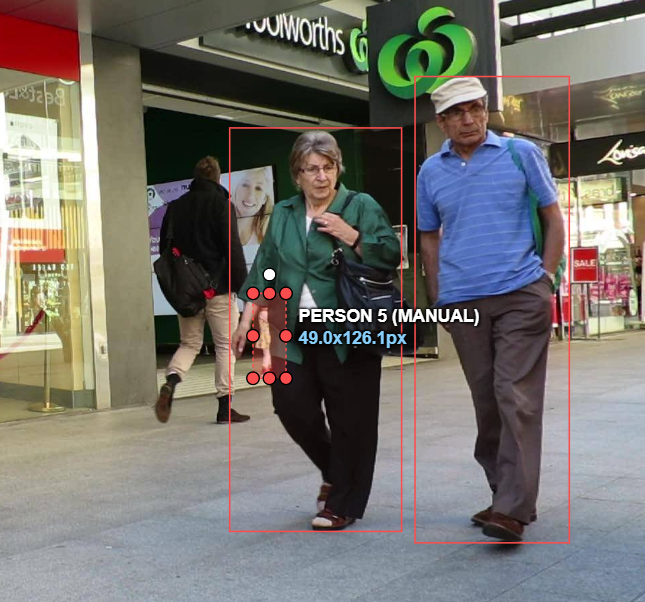
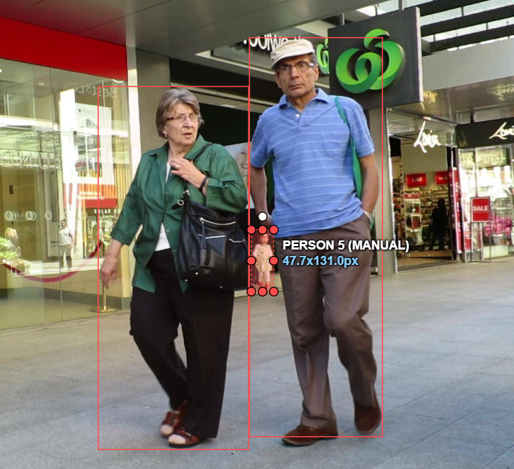

# Báo cáo cá nhân — HoVaTen-MSSV

Đổi tên file theo quy tắc `MSSV_HoTen.md`. Ví dụ: `20241234_NguyenVanAn.md`.

Đoạn video: MOT17-09, 150 frame (frame 1–150), nguồn MOTChallenge, giấy phép CC BY-NC-SA 3.0.

## 0. Thông tin học viên

- Họ tên: Nguyễn Hữu Huy Anh
- MSSV: 2A202603170
- Mã đề (A/B/C): B
- Email: huyanh261002@gmail.com
- Link repository: https://github.com/Anhnato/K5-L2-DAY05-NguyenHuuHuyAnh-2A202603170-MOTTracking.git
- Giờ bắt đầu: 17:00
- Giờ kết thúc:

## 1. Xem trước đoạn video (CP0)

Ghi **trước khi vẽ**, mỗi người một dòng.

| Mã | Frame xuất hiện | Frame cuối thấy được | Rẽ / dừng / đổi tốc độ ở frame | Bị che ở frame | Ghi chú |
|---|---|---|---|---|---|
| P1 | 0 | 149 | | 50 | |
| P2 | 0 | 149 | | | |
| P3 | 40 | 149 | | 40 | |
| P4 | 0 | 139 | 60 | 110 | |
| P5 | 0 | 109 | 60 | 100 | |

## 2. Keyframe và thời gian (CP1, CP4)

Số keyframe lấy từ kết quả `src/check_submission.py`.

| Mã | Số keyframe | Keyframe ở frame | Số frame có mặt | Keyframe / 100 frame | Thời gian (phút) | Chỗ khó |
|---|---|---|---|---|---|---|
| P1 | 9 | [0, 10, 20, 30, 40, 50, 89, 90, 100] | 0–108 | 8.3 | 30 | |
| P2 | 23 | [0, 10, 20, 28, 30, 32, 34, 36, 39, 40, 50, 54, 60, 70, 75, 80, 90, 100, 110, 120, 130, 140, 149] | 0–149 | 15.3 | 30 | |
| P3 | 21 | [0, 10, 20, 30, 40, 50, 60, 70, 80, 90, 100, 110, 120, 122, 123, 124, 125, 126, 130, 140, 149] | 0–149 | 14.0 | 30 | |
| P4 | 14 | [40, 50, 60, 70, 80, 90, 100, 110, 120, 121, 130, 140, 141, 149] | 0–146 | 12.7 | 30 | Người bị outisde dễ lỗi ID |
| P5 | 10 | [0, 10, 20, 30, 40, 50, 100, 106, 110, 140] | 40–149  | 8.5 | 30 | |
| **Tổng** | 77 | | | | 150 | |

Keyframe / 100 frame của cả bài = tổng keyframe ÷ tổng số frame có mặt × 100 = 77 / 149 x 100 = 43.01676

Bạn đặt keyframe nhiều nhất ở người nào? Vì sao (người đó rẽ, dừng, lại gần camera hay bị che)?
Tôi đặt keyframe nhiều nhất vào người phụ nữ áo xanh vì người đó rẽ nhiều nhất 

## 3. Đoạn bị che (CP2)

Người bị che: `P4`

| Mốc | Frame |
|---|---:|
| Bắt đầu bị che một phần (bật `occluded`) | 106 |
| Mất hẳn (bật `outside`) | 111 |
| Hiện lại (tắt `outside`) | 140 |
| Thấy rõ trở lại (tắt `occluded`) | 140 |

- Thời gian khuất hẳn: 6 frame = ___ giây.
- Quyết định: giữ cùng ID.
- Lý do (trả lời 3 câu: khuất bao lâu so với 60 frame, ngoại hình có khớp, chỗ hiện lại có đúng hướng và tốc độ): 
   P4 khuất tầm 6 frame so với 60 frame.
   Khớp ngoại hình thông qua dáng người nhỏ, váy vàng và giày hồng.
   Đúng hướng và tốc độ.

...

Ảnh chụp màn hình:

## 4. Tự review ID (CP3)

Lượt 1 theo người (đi ngược từ frame 149 về 0 trên CVAT), lượt 2 theo cảnh (nhảy 10 frame). Ít nhất 3 dòng; không có lỗi thì ghi một dòng "đã kiểm hai lượt, không lỗi".

Loại lỗi dùng đúng một trong 7 mã: `id_switch`, `fragmentation`, `lost`, `merge`, `false_track`, `drift`, `flag`.

| Frame | Mã người | Loại lỗi | Mô tả một câu | Phát hiện ở lượt | Đã sửa? |
|---:|---|---|---|---|---|
| "đã kiểm hai lượt, không lỗi". | | | | | |
| | | | | | |
| | | | | | |

Tổng hợp số lỗi theo loại:

| `id_switch` | `fragmentation` | `lost` | `merge` | `false_track` | `drift` | `flag` |
|---:|---:|---:|---:|---:|---:|---:|
| | | | | | | |

Lỗi nào chỉ lượt 2 (theo cảnh) mới thấy, lượt 1 (theo người) không thấy? Vì sao?

...

## 5. File xuất và kết quả tự kiểm (CP4)

| Kiểm tra | Kết quả |
|---|---|
| Tên file MOT 1.1 | NguyenHuuHuyAnh_mot.zip |
| Tên file CVAT for video 1.1 | NguyenHuuHuyAnh_cvat_video.zip |
| Số track ID khác nhau trong `gt/gt.txt` (phải là 5) | 5 |
| Frame `outside` không có dòng trong `gt.txt` (đúng / sai) | đúng |
| Job đã completed trên CVAT máy cá nhân | đúng |

Dán phần tóm tắt in ra từ `src/check_submission.py`:

=== Tóm tắt ===
  Lỗi: 0   |   Cảnh báo: 0
  Đạt. Dán phần tóm tắt này vào báo cáo mục 5.

## 6. Ba câu kết

1. Nếu được gán lại, bạn sẽ đặt keyframe khác ở đâu? Vì sao?

   Nếu gán lại, tôi sẽ đặt keyframe khác cho P4 ở frame số 138. Vì tại frame 138 P4 đã xuất hiện lại trong trạng thái `occluded`.
   ...

2. Có chỗ nào bạn không chắc "cùng ID hay ID mới"? Bạn đã quyết định và ghi chú thế nào?

   Với P4 tôi không chắc khi người này xuất hiện lại từ trạng thái `outside` tôi không chắc người đó sẽ gán ID mới hay cùng ID nên tôi đã kiểm tra lại file `GUIDELINE.md` nhưng vẫn không chắc nên tôi đã hỏi Lab Coach.
   ...

3. Một lỗi ID trong job của bạn (nếu không còn sót, chọn lỗi đã sửa) có thể làm xe tự lái dự đoán sai chuyển động của người đó như thế nào? Lỗi đó ảnh hưởng MOTA hay IDF1 nhiều hơn?
   Lỗi một người có hai ID khác nhau sẽ ảnh hưởng đến chỉ số IDF1 vì lỗi này ảnh hưởng đến IPTP, IDFP và IDFN.
   ...

## Bonus (nếu làm)

### B1 — Hai người đi sát

...

### B2 — So cách đặt keyframe

| Cách đặt | Số keyframe | Frame trôi nhất | Ghi chú |
|---|---:|---:|---|
| Đều mỗi 30 frame | | | |
| Theo chỗ đổi hướng | | | |

...

### B3 — So với tracker có sẵn

| Frame | Mã người | Tracker làm gì | Nhãn của bạn | Giải thích (đoán rồi sửa / ghép IoU / box score thấp / ngoại hình) |
|---:|---|---|---|---|
| | | | | |
| | | | | |

## 7. Tài liệu tham khảo và công cụ AI đã dùng

...
